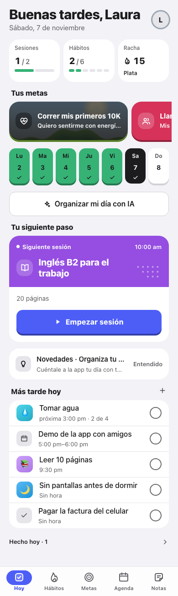
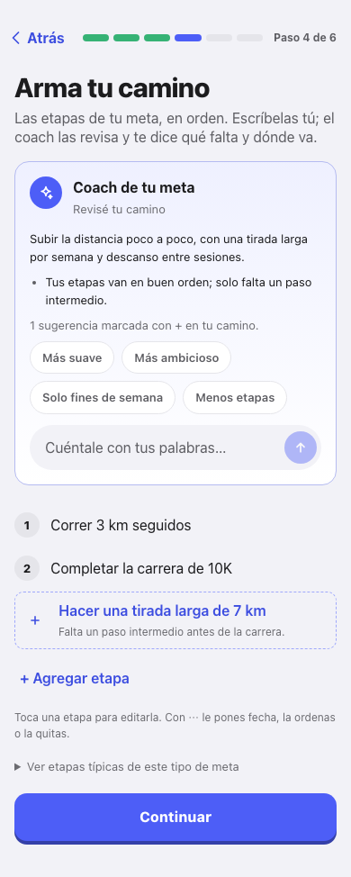
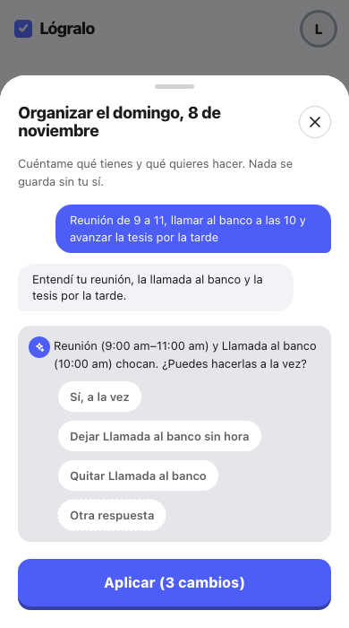
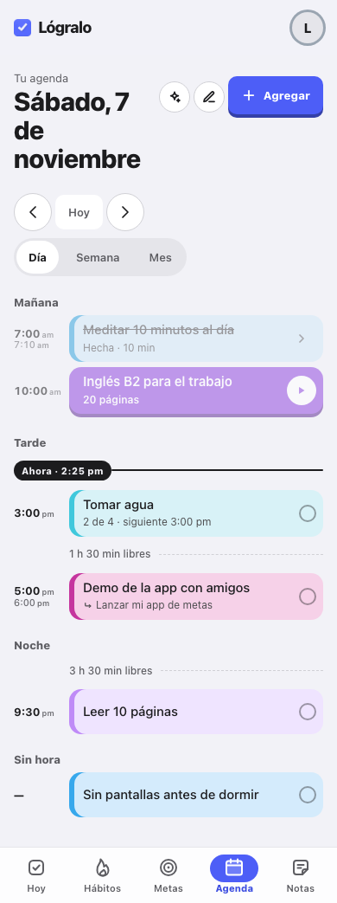

# Lógralo

App para lograr metas personales con guía. Defines lo que quieres lograr, un
coach con IA te ayuda a armar el camino y la app lo convierte en sesiones,
hábitos y una agenda diaria que sí cabe en tu día.

**Demo:** [hitos-version1.vercel.app](https://hitos-version1.vercel.app) · PWA
mobile-first, en español.

| Hoy | Coach de la meta | Organizar el día con IA | Agenda |
| :-: | :-: | :-: | :-: |
|  |  |  |  |

> Proyecto personal y pieza de portafolio full-stack. Las capturas usan datos
> ficticios.

## Qué hace

- **Asistente para crear metas.** Pregunta qué, por qué, para cuándo y cómo sabrás
  que lo lograste. Detecta el tipo de meta y propone etapas, horario semanal y
  criterio de éxito.
- **Coach con IA por meta.** Revisa el camino, sugiere etapas que faltan, responde
  dudas y propone cambios que la persona aplica con un botón.
- **Hoy.** La siguiente sesión, los hábitos del día, la racha y lo que queda
  pendiente, en una sola pantalla.
- **Sesiones guiadas.** Temporizador, pausa y registro de lo que se avanzó.
- **Hábitos.** Varias veces al día, saltar un día sin romper la racha, pausa y vínculo con una meta.
- **Agenda por bloques.** Día, semana y mes. Lo que coincide en la misma hora se
  agrupa, y muestra el tiempo libre entre actividades.
- **Organizar el día con IA.** La persona cuenta su día con sus palabras. La app
  arma un borrador sin choques, pregunta lo que falta (duraciones, qué se puede
  hacer a la vez) y nada se guarda hasta pulsar "Aplicar", que se puede deshacer.
- **Notas, progreso y lecturas cortas** sobre cómo sostener una meta.
- **Recordatorios push** con una Edge Function de Supabase.

## Cómo usa la IA

La regla del proyecto es **la IA entiende, el código decide**.

- El modelo interpreta el texto libre y responde en JSON validado con un esquema.
  Las decisiones con consecuencias son código puro y probado: ubicar actividades
  en el día, detectar choques, aplicar o deshacer cambios.
- Las claves de IA viven solo en el servidor (`api/plan-meta.ts`, función de
  Vercel). El navegador nunca las ve.
- **Cadena de respaldo:** si un modelo falla (saturación, límite, respuesta
  inválida), pasa al siguiente: Gemini → Groq → OpenRouter
  (`src/server/aiChain.ts`).
- **Límite diario por persona** guardado en Postgres, con cobro atómico y
  devoluciones solo cuando la IA falla (`supabase/migrations/0020`, `0021`).
- **Defensa ante engaños:** el texto de la persona va delimitado y sin
  posibilidad de cerrar sus etiquetas, y el modelo rechaza lo que no es de la app
  (`src/domain/promptData.ts`).

## Stack

- **Frontend:** React 19, TypeScript estricto, Vite 6, React Router 7, PWA con
  `vite-plugin-pwa`. Sistema de diseño propio (tokens CSS) e íconos SVG, sin
  librerías de UI.
- **Backend:** Supabase (Postgres, Auth, Row Level Security, Edge Functions) y una
  función serverless en Vercel para la IA.
- **IA:** Gemini, Groq y OpenRouter, con salida JSON por esquema.
- **Calidad:** Vitest, Playwright, ESLint con reglas de arquitectura, Conventional
  Commits, lefthook, GitHub Actions y SonarCloud.

## Arquitectura

```
src/
├─ domain/      Lógica pura y probada, sin I/O: plan del día, agenda, rachas,
│               plantillas, prompts y lectura de respuestas de la IA
├─ server/      Handler de la IA: cadena de modelos, cuota y validación
├─ services/    Acceso a datos tipado (Supabase)
├─ hooks/       Estado de pantallas y caché de sesión
├─ screens/     Hoy, Metas, Asistente, Hábitos, Agenda, Notas, Progreso, Perfil…
├─ components/  UI reutilizable
└─ styles/      Tokens y estilos

api/            Función de Vercel (/api/plan-meta)
supabase/       schema.sql, migraciones con RLS y la Edge Function de recordatorios
e2e/            Pruebas de Playwright con Supabase e IA falsos
```

- `domain/` no importa nada de la UI ni de la base de datos; una regla de ESLint lo
  hace cumplir.
- Toda tabla nace con RLS y sus políticas en la misma migración; `npm run check:rls`
  lo verifica.

## Calidad

- Pruebas unitarias del dominio y del servidor (`npm test`) y pruebas e2e de los
  flujos con IA (`npm run e2e:coach`).
- CI en cada PR: tipos, lint, RLS, pruebas y build (`.github/workflows/ci.yml`).
- Hooks de git: lint y RLS antes de cada commit, Conventional Commits, y tipos y
  pruebas antes de cada push.

## Puesta en marcha

1. Instala las dependencias:

   ```bash
   npm install
   ```

2. Crea un proyecto en [supabase.com](https://supabase.com). En **SQL Editor**,
   corre [`supabase/schema.sql`](./supabase/schema.sql) y después cada archivo de
   [`supabase/migrations/`](./supabase/migrations) en orden (0002 a la última).

3. Copia las variables de entorno y completa la URL y la `anon key` de Supabase
   (**Project Settings → API**):

   ```bash
   cp .env.example .env
   ```

   La `anon key` es pública por diseño; la seguridad la dan las políticas RLS. Para
   la IA agrega al menos `GEMINI_API_KEY`. Esas claves solo las lee el servidor.

4. Corre la app. El servidor de desarrollo también monta `/api/plan-meta`:

   ```bash
   npm run dev
   ```

Para probarla en el celular, abre la URL **Network** que imprime `npm run dev`
(misma red Wi-Fi) y usa **Compartir → Agregar a pantalla de inicio**.

Los recordatorios push necesitan desplegar la Edge Function; la guía está en
[`docs/notificaciones.md`](./docs/notificaciones.md).

## Scripts

| Comando | Qué hace |
| --- | --- |
| `npm run dev` | Servidor de desarrollo, con la función de IA y acceso desde la red local |
| `npm run build` | Chequeo de tipos y build de producción |
| `npm test` | Pruebas unitarias (Vitest) |
| `npm run e2e:coach` | Pruebas e2e de los flujos con IA (Playwright) |
| `npm run lint` | ESLint, con reglas de arquitectura y de secretos en el cliente |
| `npm run check:rls` | Falla si una tabla no activa RLS en su mismo archivo |
| `npm run check:api` | Verifica que la función de Vercel cargue en Node |
| `npm run shots` | Capturas de todas las pantallas con datos ficticios |

## Lo que viene

- Dictar el día por voz en el organizador de la agenda.
- Que el organizador recuerde el horario habitual y las combinaciones que la
  persona ya confirmó.
- Replanificar el día en vivo cuando algo se atrasa.

---

Hecho por [Joan Mateo Cardona](https://github.com/JoanMateo77).
